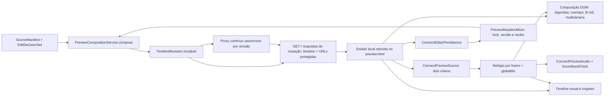

# Auditoria de performance do editor Filadélfia

Data: 16/11/2026. Base: commit `0867fd0831f77f61c579913c7e606c27b5f16e6a`.

Atualização posterior: a primeira rodada autorizada de correções está descrita em [Estabilidade do preview](external_media_preview_stability.md). Este relatório e os resultados associados preservam o diagnóstico da revisão-base.

## Parecer e limites da evidência

**Manter e otimizar a arquitetura atual.** Há mecanismos úteis já implementados: dois buffers para o vídeo principal, descarte lógico de operações antigas, relógio por frame, reconciliação de nós, snapping por busca binária, caches persistentes de thumbnails/waveforms e persistência serializada com idempotência. Recomendar essas mesmas técnicas como se não existissem esconderia os problemas restantes.

As prioridades são recuperar transições que deixam de progredir, limitar a retenção de mídias secundárias, corrigir a apresentação de frames dessas camadas e reduzir o trabalho que ainda escala com o projeto. Não há evidência nesta execução que justifique React, Canvas/WebGL para toda a composição ou uma reescrita do editor.

Esta auditoria combina leitura dos caminhos frontend/backend, execução da suíte JavaScript e sondagens isoladas no Chrome com mídia sintética. **Não é um benchmark do editor completo nem da produção.** Não foram medidos bytes de memória, FPS do editor, latência com S3, perfil SQL, estabilidade de 30 minutos ou dispositivos móveis. Retenção de elementos com `src` não prova que todos mantenham decodificadores ativos; estes últimos precisam ser observados no navegador/processo de mídia.

Entregáveis auxiliares: [sondagem reproduzível](performance_audit/browser_probe.cjs) e [resultados desta execução](performance_audit/results.json). Somente documentação e diagnóstico foram adicionados; os arquivos de execução do produto permaneceram intactos. Não houve deploy, acesso a projetos reais, alteração de banco, migration, render de produção ou operação no S3.

### Classificação usada

- **Confirmado no código:** comportamento ou custo demonstrável pela implementação, sem atribuir uma latência ainda não medida.
- **Reproduzido:** observado nesta execução, com o alcance e as condições indicados.
- **Hipótese:** relação causal plausível que depende de perfil ou ambiente real.
- **Oportunidade:** melhoria a avaliar apenas se a medição justificar.

## A. Mapa da arquitetura atual

### Entrada correta e fluxo de dados

O editor com múltiplas faixas é `templates/member/external_media/preview.html` (2.296 linhas nesta revisão). `editor.html` é outro fluxo, voltado a legendas; não é o motor descrito no pedido.



| Área | Arquivos e pontos relevantes | Papel atual |
|---|---|---|
| Página e payload | `website/views/external_media.py:2107`, `:2517`, `:2580` | GET, respostas completas de revisão, URLs de proxies e metadados de música |
| Composição canônica | `website/external_media/preview.py:652`, `:720`, `:1074`, `:2114` | Combina fontes, cortes e decisões; cria revisão e incrementa versão editorial |
| Exportação | `website/external_media/timeline.py:108`, `:261` | `InternalTimelineBuilder`, contrato `connect.internal_timeline.v1` e trilhas para entrega/exportação |
| Fontes do preview | `static/external_media_preview_source.js:8` | `ConnectPreviewSource`: seek, warm, reserva e troca dos dois vídeos |
| Relógio da página | `preview.html:714`, `:723`, `:959`, `:994` | `seek`, `warmNextClip`, callbacks de frame e passagem de take |
| Camadas | `preview.html:744`, `:777`, `:782`; `static/external_media_multicam.js:25` | `renderPosition`, overlays, B-rolls e uma câmera adicional |
| Áudio | `static/external_media_preview_audio.js:7`, `:284` | Canais, crossfade, ducking/keyframes; música segue frames e watchdog |
| Interação | `preview.html:1122`, `:1187`, `:1219`, `:1237`, `:1442`, `:2024`, `:2062` | Snapping, reorder, drag/resize, reconciliação, scrub, zoom |
| Consultas derivadas | `static/external_media_editor_view.js:15`; `static/external_media_editor_precision.js:13` | Índices de intervalos e busca binária de alvos magnéticos |
| Persistência | `static/external_media_editor_state.js:4`; `website/external_media/editor_persistence.py:14` | Fila única, coalescência, UUID, retry idempotente, conflito por versão |
| Proxies e transporte | `preview.py:59`, `services.py:2323`, `views/external_media.py:143`, `:2263`; `external_media/streaming.py:10` | Geração/reuso, redirecionamento assinado ao S3 ou streaming com Range |
| Mídia derivada | `external_media/preview_artifacts.py:34`, `:79`; `static/external_media_cached_media.js:3` | Waveform de 4.096 picos, thumbnail persistida, comparação de ruído e polling |

As referências `preview.html:N` desta auditoria são relativas a `templates/member/external_media/preview.html`. Números de linha se referem ao commit acima.

### Como o preview interpreta a timeline

O navegador recebe uma projeção da revisão com `clips`, `assets`, `captions`, `brolls`, `overlays`, `decisions`, `camera_segments` e dados de áudio. Não executa o `InternalTimelineBuilder` Python em tempo real nem é um consumidor genérico de qualquer trilha arbitrária: a página conhece explicitamente essas coleções. A composição de preview e a construção de exportação são caminhos relacionados, com representações próprias; paridade deve continuar sendo testada.

Há três relógios explicitamente tratados: tempo editado (`globalMs`), coordenada do master anterior aos cortes e tempo local da fonte. `editedToMaster`, `masterToEdited`, `editedToPlayback` e `playbackToEdited` (`preview.html:582–609`) fazem o mapeamento. Um proxy contínuo já editado usa tempo editado diretamente; fontes individuais usam `source_in_ms` mais o deslocamento dentro do clip. A aprovação fixa uma revisão para entrega; a sessão guarda posição e histórico por membro.

### Players, carregamento e eventos

- O principal tem **dois elementos reutilizáveis**, não um vídeo por take. O segundo é criado no construtor de `ConnectPreviewSource`, fica no DOM e alterna de papel com o primeiro. Ambos usam `preload='auto'`.
- `warmNextClip` procura a próxima descontinuidade; cortes contíguos da mesma mídia não exigem troca. Cortes descontínuos do mesmo arquivo podem usar o segundo decoder. Não existe uma janela adaptativa por bytes ou dispositivo para esses dois buffers.
- `warm` carrega a fonte futura, faz um `play()` mudo de preparação e volta à posição inicial. `isPrepared` exige proximidade temporal de um frame e, em autoplay, dados futuros de até 120 ms ajustados à velocidade e ao fim da fonte. Esse é um limiar de prontidão, não uma medição de gap.
- Uma troca preparada apresenta o novo vídeo, pausa/oculta o anterior e recicla o buffer. Uma troca fria altera `src` do vídeo atual e tenta guardar a imagem anterior em Canvas/JPEG. Há fallback após oportunidades de RAF porque um decoder pausado pode não gerar outro callback de frame.
- `requestId`, `loadId`, `preloadRequestId` e `AbortController` protegem callbacks de fontes antigas. Isso cancela listeners e validade lógica; não cancela universalmente download/decode já iniciado no navegador.
- `loadedmetadata`, `loadeddata`, `seeked`, `canplay`, `progress` e `error` participam da prontidão. `waiting`, `seeking`, `emptied`, `ratechange` e erro cancelam a fronteira agendada da página. `playing` e avanço de frame autorizam música; `stalled` só a bloqueia quando faltam dados futuros. O watchdog de 400 ms é do áudio, não recupera o vídeo.
- `bindVideoEvents`, `SoundtrackClock.setVideo` e multicâmera usam `WeakSet` para não duplicar listeners ao reciclar os dois vídeos. Handlers temporários de drag são removidos ao finalizar. Não foi encontrada evidência de listeners principais multiplicando a cada take. Há ausência de um contrato geral `dispose`, relevante para futura remontagem, mas o fluxo atual monta uma página única.

### Composição e inventário de recursos

A composição de vídeo é DOM/CSS: transformações, filtros CSS/SVG, z-index, imagens e dois nós de legenda. Canvas é usado para waveforms, medição de texto e captura de frame; não compõe continuamente a imagem final. Há cache de estilo de legenda e índices de intervalos para legendas/B-roll/overlays. Overlays usam Web Animations na entrada; B-rolls calculam entrada/saída/movimento a partir de `globalMs`.

O proxy contínuo pode trazer as camadas já renderizadas; `reviewRenders` evita desenhá-las novamente. Fica pendente enquanto o worker trabalha e sua ativação é adiada durante playback. Ajustes manuais podem voltar às fontes editáveis. Comparar os modos SOURCE/READY é obrigatório ao medir.

Inventário estrutural: **2 vídeos principais + 1 vídeo de câmera + B vídeos de B-roll já visitados + até 1 worker legado de filmstrip**. `B` é a quantidade de itens de vídeo visitados ainda retidos no DOM, não a quantidade de arquivos únicos nem de camadas simultâneas. Imagens/overlays também permanecem ocultos. A câmera é criada mesmo sem segmento ativo; conserva a última fonte ao sair. O worker legado de thumbnail tem limpeza de `src`, mas a rota normal atual usa JPEG persistido e não o aciona.

Áudio fica fora de `querySelectorAll('video')`: um canal por clip musical configurado, reusando o áudio inicial; um player de amostra e comparações de ruído no inspetor. A playlist agendada carrega/descarrega canais numa janela de aproximadamente ±10 s, com antecipação adicional de um próximo item até 20 s. Playlist legada busca duração de todas as fontes. Elemento existente, fonte carregada, buffer e decoder ativo devem ser contados separadamente.

## B. Gargalos e falhas identificados

### F01 — Retenção de B-roll visitado, sem limite de recursos — P0

**Evidência:** `preview.html:782–810`, `renderBrolls`: cria um `<video>` por `item.id`. Ao sair, faz `hidden=true` e `pause()`, sem retirar `src`, chamar `load()` para descarregar ou remover referências/nó. Revisitar o mesmo item reutiliza o nó; visitar itens novos acumula nós. O mesmo arquivo em vários itens gera vários elementos. A consulta de todos os nós históricos também cresce a cada frame.

**Reproduzido:** 12 itens sequenciais com o mesmo Blob WebM resultaram em 12 elementos ocultos, todos com `src` e `readyState>=2`, após sair de todos os intervalos. É retenção confirmada; crescimento em MB, quantidade de decoders e causa do travamento em produção ainda são hipóteses. Projetos que usam somente o vídeo principal não têm esse crescimento por take.

**Validação:** sessão com 50/100 B-rolls, ida/volta e remoções; heap, processo de mídia e bytes de rede. Confirmar retorno a um patamar após a janela sair. Incluir troca para proxy READY e substituição de asset.

**Sugestão:** manter nós apenas para camadas visualmente necessárias e uma margem próxima; nos distantes executar pausa, descarregamento e remoção das referências. Um pool por papel visual/camada deve suportar sobreposições reais. Não impor um único vídeo global: fala pode continuar audível sob B-roll e multicâmera.

### F02 — Transição reservada pode não terminar — P0

**Evidência:** `external_media_preview_source.js:52–75`, `:273–321`: um warm compatível ainda não pronto pausa o principal, marca loading e aguarda eventos. Não há prazo, detector de ausência de progresso nem recuperação nessa reserva. Erro explícito tem fallback e é coberto por teste; ausência de evento é um caso diferente. Caminho frio também pode ficar em loading se metadados/dados não chegarem e não houver erro.

**Reproduzido parcialmente:** preloader reservado sem readiness/error continuava pendente com principal pausado aos 1.200 ms; a falta de prazo é confirmada por inspeção, não por aguardar indefinidamente. O watchdog da trilha para a música, mas não sai desse estado do vídeo.

**Impacto:** espera prolongada percebida como travamento; o motivo pode ser rede, decode, priming ou política de reprodução. Não prova deadlock em toda pausa entre takes.

**Validação:** bloquear resposta local, entregar somente metadados, rejeitar priming e simular ausência de `progress`; pausar ou fazer novo seek durante cada estágio.

**Sugestão:** orçamento de progresso e tempo por geração do pedido, erro recuperável visível e retry/caminho frio controlado; timers antigos nunca podem retomar autoplay. Não liberar um frame incorreto só para esconder a espera.

### F03 — B-roll usa tolerância de playback no seek pausado e corrige loop continuamente — P1

**Evidência:** `preview.html:807`: só atualiza `currentTime` se diferença absoluta superar 350 ms, inclusive pausado. Um scrub de 200 para 300 ms pode manter a imagem antiga. Além disso, compara contra tempo absoluto antes de aplicar módulo: `abs(currentTime-expected)>.35`, seguido de `currentTime=expected%duration`. Depois da primeira volta, tempos equivalentes de loop continuam parecendo distantes. Não verifica `node.seeking`; chama `play().catch` a cada render ativo.

**Sondagem com propriedades controladas:** 0 atribuições para seek pausado de 200→300 ms; 5 atribuições em 5 renders para vídeo de 1 s, tempo corrente 0,2 s e destino 2,2 s. O segundo resultado valida o ramo do algoritmo, não mede comportamento de um decoder real em loop.

**Impacto:** scrub secundário impreciso; seeks repetidos podem interromper B-roll e competir com o principal. Só loops/trechos que ultrapassam a duração ativam o segundo problema.

**Validação:** frame numerado em B-roll pausado, loops, `source_in_ms`, velocidades e estados `seeking/waiting`; contar atribuições e frames apresentados.

**Sugestão:** calcular destino normalizado antes de comparar; distância circular apropriada ao loop; destino final pausado com precisão de frame; no playback, corrigir somente drift relevante e um seek por decoder em andamento, guardando o destino mais recente. Acionar play só na mudança de intenção/estado. Pausa de buffering do principal deve chegar também às camadas: `paused=false` sozinho não demonstra avanço de frames.

### F04 — Multicâmera recarrega por segmento e pode ocultar frame pronto — P0/P1

**Evidência:** `external_media_multicam.js:161–207`: a identidade inclui `segment.id`, `start_ms` e URL; mudar segmento recarrega `src` mesmo quando a fonte é igual. Não existe buffer antecipado dessa câmera. Correção só ocorre acima de 250 ms e `hasFrame=true` é atribuído exclusivamente em `seeked`, não em `loadeddata`.

**Reproduzido com decoder nativo:** segmento começando em fonte zero, preview pausado em zero, `currentTime=0`, `readyState=4` e câmera ainda `hidden=true`. Não foi necessário seek, portanto o evento que liberaria a imagem não aconteceu. Esse é um problema de consistência, mesmo num projeto pequeno.

**Impacto:** câmera ausente na posição solicitada e possível flash da principal/latência entre segmentos; limite de 250 ms também é inadequado ao frame final de scrub. A câmera oculta conserva a última mídia.

**Validação:** zero, salto menor que 250 ms, duas seleções contíguas da mesma fonte, troca rápida de câmera, eventos tardios e alinhamento com `rate` diferente de 1.

**Sugestão:** prontidão baseada no destino e geração de fonte, com caso válido sem seek; reusar mídia pela URL/identidade e separar identidade editorial de identidade do recurso. Preparar próxima câmera somente quando a medição justificar; liberar fonte distante. Não copiar indiscriminadamente mais dois buffers para cada camada.

### F05 — Scrubbing do principal já coalesce eventos, mas não regula decode — P1

**Evidência:** `preview.html:2024–2029`, `external_media_editor_state.js:17`, `external_media_preview_source.js:126–135`. `frameLatest` usa o último evento por RAF e descarrega o último ao soltar. Isso limita chamadas por frame da UI, não a capacidade do decoder. Cada chamada de mesma fonte atribui `currentTime`, sem comparar destino atual nem aguardar seek anterior. Mudança de take pode reatribuir `src`; `seek` também chama `warmNextClip` e toda a composição em cada amostra.

**Impacto:** sobreposição de operações de mídia e preloads obsoletos; main thread e decode disputam o orçamento. Não há uma fila JavaScript crescente de cada pointermove; o navegador pode substituir seeks internamente, e isso deve ser medido, não presumido.

**Validação:** contar eventos de entrada, pedidos após RAF, atribuições reais de tempo, carregamentos, seeks concluídos e frame final por ID. Usar scrub alternado entre muitas fontes e comparar hot/cold cache.

**Sugestão:** coordenador latest-wins por decoder com um destino pendente substituível; não perder a atualização final após `seeked`; deduplicar por tolerância de frame e priorizar o destino atual sobre warm. Decidir frequência por medições, sem um throttle fixo que piore todos os dispositivos. Frame aproximado durante gesto deve ser identificado internamente; frame final deve convergir ao destino exato disponível.

### F06 — Trabalho por frame ainda percorre histórico, decisões e todos os canais — P1

**Evidência:** `renderPosition` (`preview.html:744`) chama multicâmera, enquadramento, cards, transcrição, overlays, B-rolls, controles, playhead e áudio em cada frame. `ConnectPreviewFraming.decisionAt` filtra decisões; `framingPlayback` é repetido por `sourceFor/playbackIn/playbackOut`. `clipAt`, `clipIndex` e `nextClipAfter` fazem buscas lineares. `warmNextClip` pode atravessar muitos clips contíguos, chamando `indexOf` a cada passo: uma cadeia longa pode custar quadraticamente por busca. `removedSegments` filtra/ordena cortes em cada conversão do master bruto.

`renderOverlays` e `renderBrolls` consultam todos os nós já visitados para ocultá-los. `ConnectPreviewAudio.prepareNear`, `positionAt`, `sync` e `applyVolumes` (`external_media_preview_audio.js:71–225`) percorrem canais, recompõem ranges e transições por tick; a janela limita mídia carregada, não esse custo de CPU. Ducking e keyframes já têm cache/busca binária. `IntervalIndex` tem busca inicial binária, mas prefixos com um intervalo muito longo podem obrigar varrer muitos itens inativos; não garante O(log N + ativos) em todo conjunto.

**Estado:** complexidade e repetição confirmadas; parcela de tempo responsável por lentidão é hipótese.

**Validação:** trace CPU com principal isolado, 100 cortes do mesmo arquivo, 100 fontes, muitos clips musicais e um overlay longo sobre muitos curtos. Comparar flame charts e frequência das funções por frame.

**Sugestão:** cache derivado por revisão/mutação local para mapeamentos, enquadramento por clip e próxima descontinuidade; atualizar propriedades estáticas apenas quando mudarem e consultar ativos por relógio. Separar frequência do frame visual e widgets que não precisam da mesma cadência, mantendo áudio e limites temporais corretos.

### F07 — Reconciliação preserva nós, mas pequenas edições ainda visitam toda a timeline — P1

**Evidência:** `preview.html:1442–1621`: mapas de todos os nós, descritores de todos os clips, atualização de classes/estilos/handlers e reconciliação de todas as faixas. Não é uma substituição completa de DOM, mas ainda é trabalho global. `applyTimeline:2012` agenda essa passagem após snapshots; transições musicais são recriadas. `stackElementLayers:1530` busca faixa livre e testa os itens de cada faixa, com pior caso quadrático. Esse cálculo acontece mesmo quando todos os B-rolls já têm camada manual.

Seleção (`:1622`) percorre todos os clips, embora preserve identidade. Transcrição (`:1698–1735`) é reconstruída integralmente em `renderList`, inclusive ao selecionar outra legenda e ao reconciliar a resposta; foco é restaurado, mas alocação/DOM continuam. Não há virtualização horizontal dos clips nem da transcrição; só waveforms têm janela visível e orçamento de dois desenhos por frame.

**Operações:** drag/resize de itens comuns atualiza geometria temporária via RAF e só persiste ao fim/debounce; é uma proteção já existente. Corte/exclusão faz remapeamento local e aplica depois o snapshot. Reorder de take aguarda flush e resposta. Criar/excluir elementos e undo/redo também voltam a snapshots globais. Zoom altera largura sem recriar clips; scroll não reconstrói faixas, mas agenda waveforms. Render inicial roda imediatamente e novamente no RAF final (`:2292–2293`).

**Validação:** `MutationObserver`, contadores de render e tempo próprio por seleção, resize, delete, criação e ACK. A fixture existente de 1.000 legendas mede callback de RAF, não pintura real nem carregamento pesado de vídeos.

**Sugestão:** atualizações por identidade/coleção suja; seleção anterior/nova; camada automática só para itens que precisam; transcrição estável. Virtualização só depois, com seleção/snapping baseados no modelo para não perder elementos fora do viewport.

### F08 — Leituras de layout intercaladas com escrita — P1

**Evidência:** `renderPosition` aplica estilos antes de `renderDirectTransformControl` ler `getBoundingClientRect` (`:855`). `renderTimelinePlayhead:1430` lê canvas/lane, escreve `top`, depois lê a última faixa; a cada frame recalcula geometria estável. Drag de take (`:1187`) lê scroller/lane/canvas após scroll; marquee (`external_media_caption_selection.js:11–28`) escreve retângulo e lê bounds de todas as legendas a cada atualização, seguido de seleção global.

**Estado:** padrão de invalidação confirmado; forced layout e duração precisam do trace.

**Sugestão/validação:** medir eventos Layout/Recalculate Style; agrupar leituras antes das escritas, cachear geometria até zoom/resize/mudança de faixas/scroll, usar coordenadas de modelo para marquee. Para mover, avaliar `transform` temporário; resize ainda exige representar comprimento corretamente. Não aplicar `will-change` em centenas de nós sem medir memória.

### F09 — Snapshot completo em cada edição e recibo completo sob transação — P1

**Evidência:** `TimelineRevisionService._create` (`preview.py:2114`) recompõe e persiste timeline inteira por alteração. `preview_revision_response` (`views/external_media.py:2517`) hidrata/duplica a timeline e devolve tudo. `PreviewMutationMixin` mantém lock de projeto durante dispatch e serialização; decodifica o JSON da resposta, guarda o objeto inteiro no `PreviewOperation.response` e serializa novamente (`editor_persistence.py:47–74`). `TimelineRevision` e recibos retêm JSON; a pilha undo tem limite de 50, mas isso não remove revisões/recibos anteriores.

**Impacto:** tráfego, CPU, armazenamento e tempo no lock crescem com timeline e histórico. A fila é assíncrona para a UI, mas backlog aumenta o tempo até confirmação. A resposta aplicada gera trabalho frontend global e pode fazer novo seek (`applyTimeline`). Tempo de banco ou storage não foi medido.

**Validação:** bytes do payload/recibo, tempo de compose, hidratação, serialização, lock e queries; fila de 20 edições e latência artificial de 500 ms/2 s, preservando conflitos/retry. Usar banco e storage descartáveis.

**Sugestão:** primeiro medir e remover hidratação/cópias/consultas duplicadas; aproveitar coalescência e não buscar fonte se relógio/asset não mudaram. Só depois considerar ACK mais enxuto ou reconciliação por patch, preservando compatibilidade e exatamente o resultado do retry. Política de retenção exige análise de histórico e idempotência; não apagar recibos/revisões como atalho.

### F10 — Captura síncrona de frame e risco de Canvas contaminado — P1 condicional

**Evidência:** `holdPreviewFrame` (`preview.html:692`) aloca Canvas nas dimensões do vídeo e executa `drawImage`/`toDataURL` JPEG no caminho frio. `protected_file_response` redireciona playback ao S3 (`views/external_media.py:143–160`); o player não configura CORS. O próprio comentário da rota `:2292` reconhece que captura após redirect cross-origin pode falhar. `catch` silencioso esconde a falha.

**Estado:** custo síncrono confirmado; falha e duração em produção são hipóteses condicionadas à origem e aos headers efetivos. Exportar Canvas sem origem limpa lança `SecurityError`, conforme [documentação CORS do Canvas](https://developer.mozilla.org/en-US/docs/Web/HTML/How_to/CORS_enabled_image).

**Validação/sugestão:** registrar sucesso/erro e tempo da captura com fontes locais e storage de teste cross-origin. Priorizar manter o último buffer apresentado; evitar JPEG síncrono em cada troca fria. CORS deve ser corrigido no transporte apenas se necessário e validado; migrar a composição para Canvas ampliaria esse requisito.

### F11 — GOP não é configurado para scrubbing — P1 experimental

**Evidência:** `VideoAssemblyService.create_proxy` (`services.py:2323–2361`) usa H.264/AAC, CFR, `yuv420p`, `+faststart`, largura/CRF do perfil, mas não fixa `-g`/keyframes. O perfil tem valores padrão 960 px, 30 fps, CRF 27, áudio 96 kbps; isso não comprova configuração efetiva de todos os projetos. Proxy contínuo também tem caminho próprio (`preview.py:358`).

**Hipótese:** distância ao keyframe contribui para seeks frios; bitrate menor sozinho não garante seek rápido. Não foi analisado GOP de um arquivo real e não se deve atribuir um GOP padrão numérico sem inspecioná-lo.

**Validação:** usar `ffprobe` em fixtures para medir keyframes, duração, timestamps e seek entre keyframes. Comparar amostras equivalentes com GOP de 0,5/1/2 s versus atual, hot/cold cache e mobile. A opção `g` mapeia `keyint` no [encoder libx264 do FFmpeg](https://ffmpeg.org/ffmpeg-codecs.html#libx264_002c-libx264rgb).

**Sugestão:** decidir pelo p95 de seek, bytes, tempo de encode e qualidade; aplicar somente ao proxy, versionar o cache se houver mudança. Não exigir all-intra sem evidência de benefício e orçamento de storage/rede.

### F12 — Diagnóstico incompleto e teste de continuidade desatualizado — P0 de validação

**Existente:** `connect:editor-save` expõe queue/request/total/attempts (`preview.html:489`, `editor_state.js:106`); `connect:preview-transition` tem warm/waiting/cold/swap/first-frame e gap excedente de callbacks (`preview.html:696–712`). É uma boa base, mas não há coleta completa de play/pause/seek/frame rate/long tasks/memória. O caminho de mesma fonte não passa por todos os eventos de troca.

**Execução:** 163/163 testes JS aprovados. O teste standalone `editor_playback_continuity.browser.cjs` falhou com `ReferenceError: playbackIn is not defined`: extrai `seek`/relógio do template, mas seu harness declara `sourceFor` sem `playbackIn/playbackOut` (`:37–49`). Não foi corrigido nesta auditoria. Ele não produziu resultado de continuidade utilizável.

**Sugestão:** reparar o harness antes das otimizações; ampliar cobertura para os casos reproduzidos e registrar diagnósticos opt-in. Resultados antigos dos documentos P0/P1 são históricos, não medições repetidas nesta execução.

### F13 — Animação de overlay segue tempo de parede, não o playhead — P2

**Evidência:** `renderOverlays` (`preview.html:780`) inicia `node.animate` ao entrar/reaparecer, sem posicionar a animação pelo tempo decorrido na timeline e sem pausá-la junto com o principal. Um seek direto ao meio de uma entrada pode reiniciar a animação; preview pausado pode continuar animando. Já os movimentos/entradas de B-roll são calculados por `globalMs`. Isso demonstra estratégias temporais diferentes, não um gargalo de GPU medido.

**Validação/sugestão:** comparar frames de entrada no início/meio/fim, pausas e scrub repetido com render de referência. Derivar progresso de animação do mesmo relógio, evitando reinicializações e preservando a fidelidade declarada. Medir o custo de Paint/Composite dos filtros, sombras e animações antes de trocar tecnologia.

## C. Plano priorizado

| Prioridade | Ordem | Entrega e fundamento |
|---|---|---|
| P0 | 1 | Corrigir harness e instrumentar baseline antes de atribuir ganhos (F12) |
| P0 | 2 | Recuperação de carregamento sem progresso e cancelamento consistente (F02) |
| P0 | 3 | Limitar retenção de B-roll e liberar mídia distante, preservando simultaneidade (F01) |
| P0 | 4 | Corrigir câmera com frame pronto sem `seeked` (parte de F04) |
| P1 | 5 | Coordenar seeks latest-wins e precisão final de camadas; normalizar loop (F03/F05) |
| P1 | 6 | Reuso/antecipação com orçamento para câmera; medir e melhorar transições frias (F04/F10) |
| P1 | 7 | Reduzir buscas e writes repetidos por frame, geometria e trabalho de áudio (F06/F08) |
| P1 | 8 | Render incremental de faixas/inspetor e evitar camadas automáticas desnecessárias (F07) |
| P1 | 9 | Perfil do backend e redução de custo de snapshot sem perder idempotência (F09) |
| P1 | 10 | Experimento de GOP, condicionado ao perfil real de seek (F11) |
| P2 | 11 | Gestos mobile, virtualização justificada por volume e ciclo de vida uniforme |
| P2 | 12 | Extração gradual de responsabilidades, animação coerente com o relógio (F13) e eventual composição híbrida medida |

P0 significa risco de bloquear edição ou apresentar imagem inconsistente; não significa que a taxa de ocorrência na produção já foi medida. Não aumentar pool/preload antes de limitar retenção e medir concorrência.

## D. Estratégia incremental de implementação e aceitação

Todas as etapas abaixo são propostas, **ainda não implementadas**. Manter milissegundos e contratos atuais de timeline/revisão. Cada etapa deve ser revisável e comparada ao mesmo cenário anterior.

| Etapa | Arquivos afetados | Mudança proposta | Risco principal | Testes | Ganho esperado e aceitação |
|---|---|---|---|---|---|
| 0 — Baseline | `static/tests/editor_playback_continuity.browser.cjs`, `preview.html`, `editor_state.js`, diagnóstico opt-in | Corrigir helpers do teste; IDs e spans de reprodução/interação; registrar recursos e long tasks | Instrumentação alterar o perfil | Diagnóstico ligado/desligado; conferir unidades/relógios e mesmo-source | Medição confiável; teste com decoder real conclui sem erro; amostras distinguem pedido e frame |
| 1 — Recuperação | `external_media_preview_source.js`, áudio e integração na página | Prazo/progresso por pedido, retry explícito, erro de play observável, cancelamento | Autoplay indevido ou descarte de buffer ainda útil | Nunca chega metadata, somente metadata, erro, novo seek/pausa, retorno da rede | Nenhuma reserva/loading sem saída; ao orçamento configurado, recuperar ou informar erro recuperável; pausa nunca é revertida por callback antigo |
| 2 — Recursos | `preview.html:renderBrolls/renderOverlays`, `external_media_multicam.js` | Janela/pool por camadas, pausa/descarregamento distante; limpar removidos | Recarregamento mais frequente ou perda de frame na fronteira | 100 B-rolls, sobreposições, mesmo asset, delete, SOURCE→READY e retorno | Quantidade com `src` depende da janela/camadas atuais, não dos itens visitados; nenhuma faixa necessária desaparece |
| 3 — Seek e câmera | `external_media_preview_source.js`, `external_media_multicam.js`, integração de B-roll | Um pedido de decode em curso e destino pendente atual, precisão pausada, caso zero, módulo de loop | Esperar `seeked` que nunca vem; alterar cortes/loop | Storm de seek, zero, offsets, erro, velocidades, GOP variado | Último frame converge em todas as camadas; nenhuma escrita redundante por volta de loop; metas de seek abaixo |
| 4 — Trabalho por frame | `preview.html`, `external_media_preview_framing.js`, `external_media_preview_audio.js`, `editor_view.js` | Cache de clock/decisões e próxima descontinuidade; propriedades sujas; leituras agrupadas | Cache inválido após edição/undo | Cortes, reorder, undo, estilo, áudio e câmera durante playback | Menor tempo próprio/allocations em trace; mesma imagem e áudio na mesma revisão; sem regressão de fronteiras |
| 5 — Interação incremental | `preview.html`, `external_media_caption_selection.js`, helpers view/precision | Atualizar clip/faixa/seleção afetados; transcrição estável; caches de geometria | Identidade errada, snapping de itens fora da tela | Drag/resize/criar/cortar/excluir, seleção múltipla, zoom/scroll, ACK lento | Nós não afetados preservados; metas de interação; snapping segue modelo e mantém semântica |
| 6 — Backend | `preview.py`, `editor_persistence.py`, `views/external_media.py` | Remover cópias/consultas demonstradas; só depois ACK enxuto se necessário | Retry mudar resultado, revisão perder integridade | Resposta perdida após commit, conflito, undo/reload, aprovação e exportação | Mesmo contrato público ou extensão compatível; menos CPU/bytes/lock medidos; edição local responde antes do ACK |
| 7 — Proxy experimental | `services.py:create_proxy`, caminho contínuo em `preview.py`, testes de proxy | Comparar GOP e versionar derivados quando adotado | Mais bytes/encode; incompatibilidade | ffprobe + vídeos numerados, CFR/VFR, áudio, Safari/Android | Redução demonstrada de seek sem drift; orçamento de qualidade/rede aceito antes de regenerar qualquer mídia |
| 8 — Mobile e escala | Interações da página, `caption_selection.js`, CSS e view helpers | Gestos explícitos e ciclo de vida; virtualizar só se necessário | Conflito com scroll/pinch e perda de seleção | Dispositivos reais, orientação, pointercancel, foco/teclado virtual | Mesma lógica editorial; tarefas executáveis por toque; recursos estabilizam em sessão longa |

### Instrumentação proposta

Usar `performance.now()` e IDs monotônicos de comando, intenção de reprodução, fonte e revisão. Instrumentação opt-in com buffer circular limitado e exportação JSON local; não acumular uma linha por frame indefinidamente. Agregar p50/p95/p99, máximo, amostras, cancelados, falhas e cenário/dispositivo. Um seek cancelado não deve aparecer como seek bem-sucedido de zero ms.

| Métrica | Início → fim e observações |
|---|---|
| Play latency | Comando do usuário → primeiro frame com avanço e intenção correspondente; registrar também promise/`playing`, que não bastam para provar apresentação |
| Pause latency | Comando → ausência de frames posteriores além do último em voo, em janela observada; separar chamada `pause`, evento e música/camadas |
| Seek latency | Pedido com ID → frame da fonte e posição desejadas dentro de um frame; separado por same-source, troca fria/preparada, scrub intermediário/final |
| Transition gap | Último frame apresentado da saída → primeiro da entrada, descontando período/velocidade; registrar freeze visível, erros e sincronismo de áudio separadamente |
| Interaction latency | Evento → alteração visual observável; usar RAF como marcador de agendamento e trace/filmagem/frame numerado para confirmar apresentação |
| Frame rate | Intervalos e `presentedFrames`/`getVideoPlaybackQuality` para vídeo; RAF para UI; quedas e duração das pausas, sem confundir FPS da UI e do decoder |
| Long tasks | `PerformanceObserver` quando suportado; tarefas acima de 50 ms, duração/frequência e fase; trace para atribuir causa |
| Memória | Heap JS + memória do processo de mídia/GPU quando disponível; snapshots antes/depois/idle; API específica só com detecção de suporte |
| Recursos | Registry incluindo `Audio` fora do DOM: total, `src`, readyState, paused, seeking, buffered; visível/audível/preparação; arquivo único e nós por papel |
| Backend | queueMs/requestMs existentes + bytes, composição, serialização, queries e lock; separar rede/worker do tempo de UI |

`requestVideoFrameCallback` oferece `mediaTime`, `presentedFrames`, `expectedDisplayTime` e `processingDuration`; o callback pode atrasar e não constitui medição física de pixels na tela. Registrar o fallback RAF como proxy mais fraco. [Especificação de callbacks de frame](https://wicg.github.io/video-rvfc/) e [documentação da API](https://developer.mozilla.org/en-US/docs/Web/API/HTMLVideoElement/requestVideoFrameCallback).

Não medir memória somente com heap JS: buffers de vídeo podem morar fora dele. Uma janela sem crescimento significativo é um critério experimental, não prova formal de ausência de vazamento.

### Cenários reproduzíveis pendentes

Fixtures locais descartáveis, mídia numerada por frame e áudio com pulsos de referência. Fixar arquivos/semente, sequência de ações, viewport/DPR, resolução/FPS, versão de navegador, CPU/memória/dispositivo, rede, modo SOURCE/READY e cache. Executar cinco repetições por condição e preservar resultados brutos; para p95 usar amostragem suficiente, por exemplo ≥100 seeks/transições por conjunto, sem apresentar p99 com amostra insuficiente.

| Cenário | Projeto e execução |
|---|---|
| Pequeno | 10 cortes, 2 fontes, 1 B-roll e 2 legendas simultâneas; 2 minutos; play/pause, 100 seeks, drag/resize, zoom/scroll |
| Médio | 50 cortes, 10 fontes, 500 legendas, até 3 camadas de B-roll, logos/texto, música/ducking/crossfade; 10 minutos |
| Grande | 100 cortes, 25 fontes, 1.000 legendas, até 4 camadas visuais simultâneas, câmera extra e 20 clips musicais; 30 minutos |
| Mesmo arquivo | 50 e 100 cortes contíguos e descontínuos do mesmo arquivo, separadamente; distingue lookup/seek de custo de abrir fontes |
| Recursos | 100 B-rolls sequenciais e depois sobrepostos; varrer, voltar, excluir/substituir; comparar contagem antes/depois e após idle |
| Scrub agressivo | 30 s de movimentos bidirecionais e saltos entre fontes; repetir pausado e durante playback; soltar em zero, fronteira e último frame |
| Falhas/transições | Fonte futura atrasada 0,5/2/5 s, interrompida e sem eventos; erro HTTP local, metadados sem dados, play rejeitado, retomada |
| Persistência | 20 edições rápidas com ACK local atrasado 0,5/2 s, resposta perdida após commit, retry, conflito entre sessões e undo/reload |
| Prolongado | Playback, seeks e edições por 30 min, três ciclos; acompanhar memória/recursos, inclinação e recuperação, sem recarregar para mascarar crescimento |
| Mobile | Repetir pequeno/médio e grande até limites declarados em iPhone/Safari e Android real; orientação, teclado, background/foreground e pouca memória |

Rede controlada só em servidor/storage de teste. Testes Django devem usar banco e storage isolados; esta execução não iniciou `manage.py test` para não depender da configuração local de serviços. O harness atual com WebM sintético não valida H.264/AAC/GOP/S3.

### Metas iniciais propostas, ainda não resultados

Referência: desktop de desenvolvimento declarado, sequência 30 fps, mídia local pronta e foreground. Comparar também Android/iOS representativos com metas próprias. Revisar após baseline; erros devem ser informados separadamente para não melhorar percentis omitindo falhas.

| Métrica | Alvo inicial de aceitação |
|---|---|
| Play/pause quentes | p95 play ≤150 ms; pause visual/áudio ≤100 ms, desconsiderando apenas o frame já em voo explicitamente registrado |
| Seek quente na mesma fonte | p95 ≤100 ms desktop, ≤200 ms mobile; frame final dentro de 1 frame da posição válida |
| Seek com troca de fonte | p95 ≤250 ms desktop / ≤400 ms mobile com mídia disponível; rede fria reportada separadamente |
| Corte preparado | p95 de gap excedente ≤1 frame; nenhum frame da fonte errada; áudio sem interrupção indevida |
| Interação | Evento→visual p95 ≤50 ms desktop / ≤100 ms mobile; trabalho principal por atualização preferencialmente dentro de 16,7 ms / 33,3 ms |
| Reprodução | Pelo menos 99% dos intervalos em playback local estável sem hiato superior a 2 frames; reportar drops, buffering e velocidade separadamente |
| Long tasks | Nenhuma >100 ms no drag/scrub do cenário médio após warm-up; explicar qualquer >50 ms repetitiva |
| Memória/recursos | Após warm-up e três ciclos, contagem de fontes retorna ao orçamento da janela/camadas; memória apresenta patamar, crescimento residual ≤10% entre finais comparáveis de ciclos, a revisar com ruído do navegador |
| Recuperação | Ao orçamento de falha configurado, inicialmente 5 s sem progresso em rede local, recuperar ou oferecer erro/retry; nunca retomar após pausa/cancelamento |
| Persistência | Preview otimista antes do ACK; 20 edições sobrevivem ACK atrasado/retry/reload; nenhum snapshot antigo substitui alterações mais recentes |

Esses limites são critérios de ensaio para negociação, não promessa universal para rede lenta ou hardware desconhecido. Registrar limite de camadas simultâneas por dispositivo a partir de testes; não esconder camadas para cumprir orçamento sem uma decisão explícita de produto.

## E. Recomendações arquiteturais e mobile

### Refinar os limites existentes

O estado temporal coerente já tem um núcleo (`globalMs` derivado do principal + mapeamentos), e o estado editorial local é uma projeção otimista da revisão persistida. São papéis diferentes, não duas fontes canônicas concorrentes por definição. `deferredTimeline`, `editorial_version` e a fila protegem contra respostas antigas; não foi demonstrado um ciclo de salvamento causado por render que reenvia continuamente a mesma mutação.

Ainda há estados espalhados (`activeClip`, `globalMs`, `sourcePlayer.target`, `loading`, seleção e cache da revisão) e acoplamento: frame chama render completo; metadados de música agendam render de timeline; snapshot reconcilia UI e pode fazer seek. A refinação deve começar por remover chamadas redundantes e definir invalidação, sem trocar contratos.

- **Playback Engine:** ampliar `ConnectPreviewSource` com coordenador de seek/progresso e relógio/intenção claros; manter o relógio musical existente e gerir ciclo de vida de mídia por papel.
- **Composition Engine:** extrair gradualmente funções DOM já existentes para consumidor de `{time, revision, active layers}`; deixar claro o que é estático e o que anima por frame. A composição não altera decisões editoriais.
- **Timeline Interaction Engine:** reunir geometria, gestos, seleção e atualizações temporárias; enviar comandos à mesma fila quando terminar o gesto. O render visual não deve dirigir persistência.

Não criar um barramento de eventos global novo para substituir chamadas simples. Preservar versão/idempotência, relógios, semântica de cortes e paridade com render/exportação em cada extração. Mudanças organizacionais sozinhas não contam como ganho de performance.

### HTML/CSS versus híbrido e WebGL

| Abordagem | Benefício e custo no código atual | Decisão |
|---|---|---|
| HTML/CSS + vídeo | Reutiliza players, texto, controles e filtros existentes; precisa limitar recursos, writes e layout. Composição/decodificação por hardware dependem do navegador, driver e efeitos; não são garantidas pelo uso de `transform` | Preferida para P0/P1; medir Paint/Composite e processo GPU |
| Híbrida HTML + Canvas | Já existe para waveforms; pode servir a thumbnails/frame de scrub aproximado e efeitos específicos comprovadamente caros. Acrescenta cópia de pixels, CORS e sincronismo | Evoluir só em ponto isolado com benefício medido; manter UI/legendas acessíveis em DOM |
| Canvas/WebGL amplo | Pode agrupar efeitos, mas não elimina decode, GOP/rede, fila de seeks, retenção ou backend. Exige textura/frame, gestão GPU, perda de contexto, CORS e paridade com FFmpeg | Sem justificativa para migração nesta auditoria; protótipo isolado somente se perfil futuro mostrar composição como custo dominante |

### Preparação mobile sem duplicar o editor

**Viável com trabalho incremental, ainda não validado em dispositivo.** Já existem Pointer Events, captura de pointer, `playsinline`, preview por aspect-ratio e alguns layouts menores. Não é necessário criar outro motor editorial. Porém existem lacunas:

| Interação | Situação atual | Preparação necessária |
|---|---|---|
| Arrastar/resize | Pointer Events e detecção de extremidade por coordenada; handles pequenos; `touch-action:none` nos clips | Área de toque adequada, modo explícito mover/recortar quando necessário, feedback sem hover |
| Scrub | Capture no canvas, estado booleano sem guardar pointerId nesse gesto | Ownership por pointerId/isPrimary e tratamento de cancel/lost capture; segundo dedo não pode iniciar outro scrub/gesture counter |
| Scroll | Scroller nativo e wheel não passivo; clips bloqueiam gestos nativos | Definir superfície de navegação e superfície de edição; não bloquear scroll/zoom da página inteira |
| Pinch | Nenhum reconhecimento dedicado encontrado | Máquina de gesto com dois pointers, zoom ancorado no ponto médio, cancelamento/transição de drag; distinguir zoom da timeline de zoom da página |
| Seleção múltipla | Shift/Ctrl e marquee; teclado para vários atalhos | Ações equivalentes por botão/estado de seleção e painéis contextuais |
| Edição | Duplo clique para texto/alguns controles; ações Del/atalhos | Acesso por toque simples e comandos visíveis; teclado como atalho complementar |
| Cancelamento | Marquee tem pointerId/lostcapture; outros gestos variam; transform persiste mesmo em pointercancel | Padronizar rollback/commit e fechamento de gesture; cancelar nunca salva uma mudança acidental |
| Layout | Preview responsivo e inspetor lateral, ferramentas densas | Medir viewport útil, teclado virtual, orientação e painel contextual; apresentação pode mudar mantendo comandos/estado |
| Players | Múltiplos vídeos mudos e áudio principal/música; priming/autoplay dependem do browser | Testar play iniciado por toque, rejeição assíncrona, pouca memória, background, retomada e limites de decode reais |

O navegador pode emitir `pointercancel` ao assumir um gesto nativo; `touch-action` deve refletir o acordo de gestos antes do movimento. [Pointer Events do W3C](https://www.w3.org/TR/pointerevents/latest/) e [documentação de touch-action](https://developer.mozilla.org/en-US/docs/Web/CSS/Reference/Properties/touch-action).

`playsinline` e mídia muda ajudam na reprodução inline, mas não são garantia de que toda combinação de priming, troca e áudio seja autorizada; tratar a promise de `play()` e testar o fluxo real. A [política documentada pelo WebKit](https://webkit.org/blog/6784/new-video-policies-for-ios/) explica os fundamentos; versões/dispositivos efetivamente suportados devem ser identificados no ensaio. Não atribuir um número universal de decoders ao Safari ou Android.

### Recomendação para a próxima autorização

Autorizar primeiro **baseline/harness + recuperação de fontes + retenção de B-roll + prontidão da câmera**, com mudanças separadas e métricas comparáveis. Em seguida, atacar seek por decoder e custo de render conforme os traces. Backend/GOP/virtualização devem seguir a evidência obtida, preservando toda a funcionalidade atual.

## Reprodução dos diagnósticos desta auditoria

Ambiente observado: Node v24.14.0, Chrome 141.0.7390.65 em Linux/headless. Playwright foi instalado somente em `/tmp/connect-performance-audit`, fora do projeto, para diagnóstico; nenhuma dependência do produto foi acrescentada.

```sh
node --test static/tests/*.test.cjs

FILADELFIA_PLAYWRIGHT_MODULE=/tmp/connect-performance-audit/node_modules/playwright-core \
FILADELFIA_CHROME_PATH=/usr/bin/google-chrome \
node docs/performance_audit/browser_probe.cjs

# Teste existente: nesta revisão falha com playbackIn não definido.
FILADELFIA_PLAYWRIGHT_MODULE=/tmp/connect-performance-audit/node_modules/playwright-core \
FILADELFIA_CHROME_PATH=/usr/bin/google-chrome \
node static/tests/editor_playback_continuity.browser.cjs
```

A sondagem extrai `renderBrolls` da página, carrega os módulos originais e gera WebM local com MediaRecorder. Isola dependências para demonstrar mecanismos; não exercita toda a interface nem persistência. Retenção e câmera usam elementos e decoder nativos. Os dois casos aritméticos de seek usam getters/setters controlados; espera sem evento é uma simulação observada por 1.200 ms. Esses alcances estão explicitados nos resultados para não converter evidência parcial em benchmark de produção.
